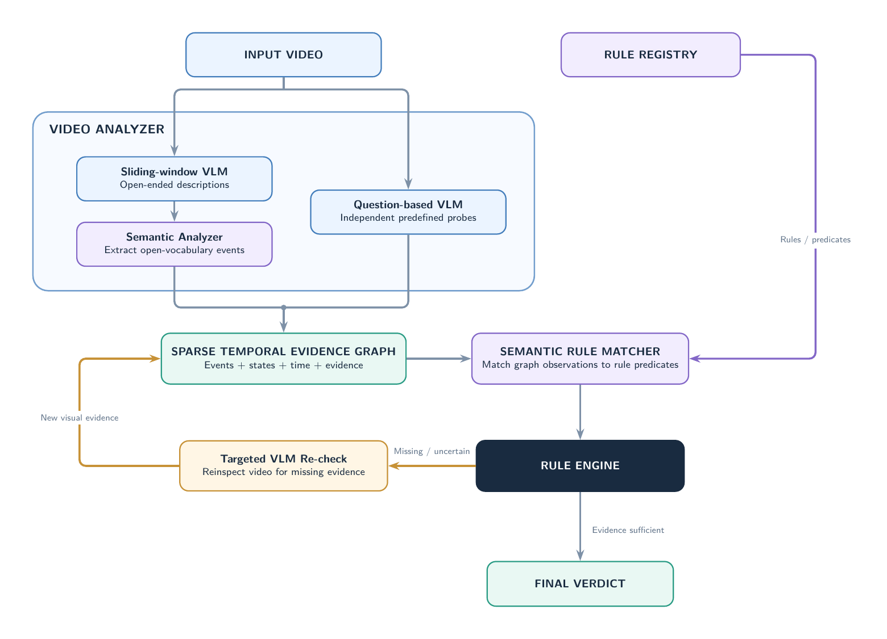

<h1> Lashyn</h1>

<p>Lashyn checks cash-desk surveillance videos against cash-operation rules and reports each violation with a timecode and evidence frames.</p>

<p align="center">
  
</p>

## Repository layout

```text
backend/   Python backend application and uv project files.
frontend/  React frontend application.
data/      Dataset videos, labels, and the original archive.
docs/      Competition case documentation.
research/  Reference papers.
```

## Requirements

- Python 3.14.8
- uv 0.13.1
- Bun 1.4.3
- FastAPI 0.143.3
- PyTorch 2.14.1
- torchvision 0.29.1
- Transformers 5.20.1
- OpenCV (headless) 5.0.0.93
- NumPy 2.5.4
- Pillow 13.0.0
- PyYAML 6.0.3
- MCG-NJU/TimeLens2-4B: `cd backend && uv run hf download MCG-NJU/TimeLens2-4B`
- React 19.3.1
- TypeScript 6.0.3
- Tailwind CSS 4.3.3

## Run

### Backend + frontend → http://127.0.0.1:3000

```sh
cd frontend && bun run start
```

### Backend → http://127.0.0.1:8000

```sh
cd backend && API_KEYS='{"dev":"xc_dev"}' uv run --locked backend
```

### Frontend → http://127.0.0.1:3000

```sh
cd frontend && bun install --frozen-lockfile && API_KEY=xc_dev bun run dev
```
